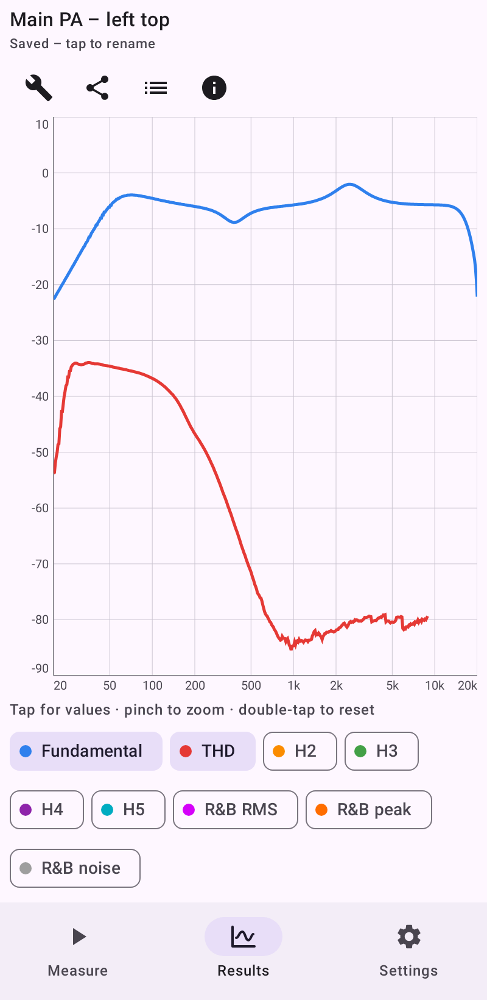
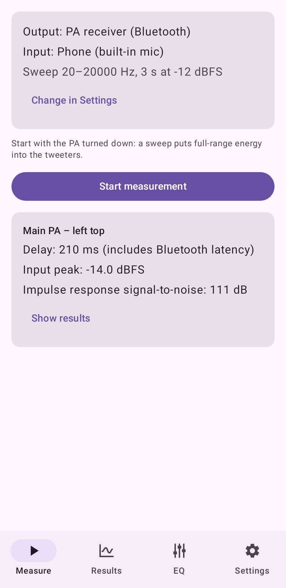
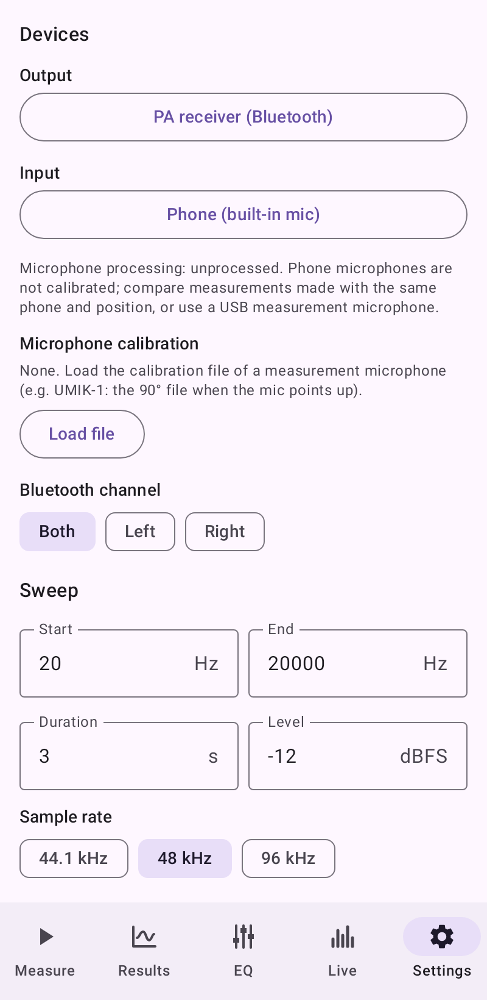
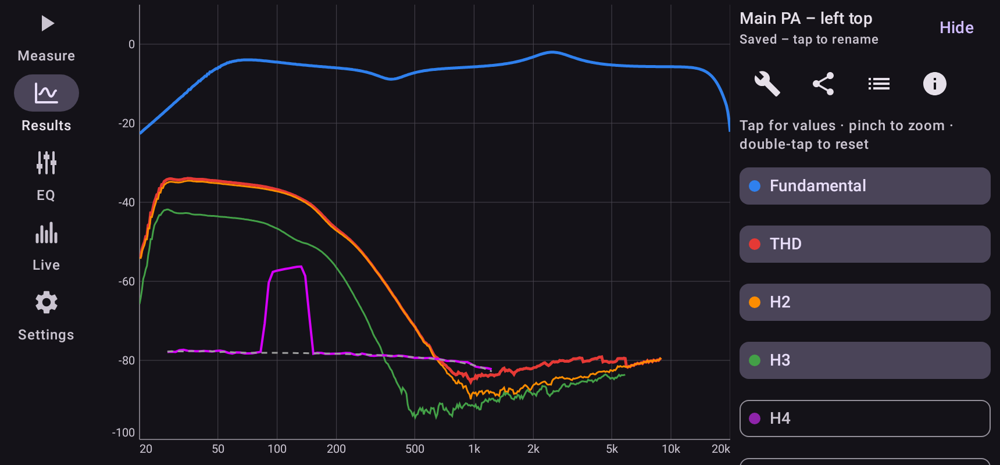

# PA Analyzer

Android app for measuring a PA system with your phone: it plays an exponential sine sweep over Bluetooth, records it with the microphone and shows, in one chart,

- **Fundamental**: frequency response of the whole chain (Bluetooth, amp, speakers, room, mic)
- **Distortion**: THD and the individual harmonics H2…H10
- **Rub & buzz**: energy far above the excitation frequency (default: above the 10th harmonic), RMS and peak, with a noise-floor reference, to find rattles, rubbing voice coils and loose parts

<p>
  
  
  
</p>
<p>
  
</p>

<sub>Screenshots show a simulated loudspeaker (bass roll-off, rising bass distortion, a rattle around 120 Hz). They are rendered by the screenshot tests and updated by CI.</sub>

## Using it

1. Connect the phone to the PA's Bluetooth receiver. The app picks the Bluetooth output automatically; choose another output, a USB measurement mic or one stereo channel under **Settings → Devices**.
2. Turn the PA **down** first. Place the phone where you want to measure (on axis, ~1 m from the speaker is a good start).
3. Press **Start measurement** on the **Measure** page. The sweep plays, the analysis runs on the phone, and the **Results** page opens.
4. Raise the level until the impulse-response signal-to-noise ratio is comfortably above 40 dB, without input clipping (the app warns about both).

### Results

- All curves share one dB axis: distortion and rub & buzz are drawn at their absolute level (fundamental + relative level), like in a spectrum. Tap the chips below the chart to show or hide curves; by default only the fundamental and THD are shown.
- Tap or drag on the chart for a cursor. The chips then show the values at the cursor: the fundamental in dB, distortion in dB and % relative to the fundamental, rub & buzz in dB relative to the fundamental.
- Pinch horizontally to zoom the frequency axis, vertically to zoom the level axis; drag with two fingers to pan; double-tap to reset.
- Turn the phone sideways to view curves: the system bars hide, the navigation moves to a slim side rail and the curve list to a side panel you can hide.
- **Save** keeps the measurement on the phone; the list button opens saved measurements (open, rename, delete) and imports CSV files. **Share** sends the measurement as CSV, which spreadsheets can read and the app can import again (e.g. on another phone).

Bluetooth latency doesn't matter: the app finds the sweep in the recording itself and reports the measured delay.

## Settings

| Setting | Default | Notes |
| --- | --- | --- |
| Start / end frequency | 20 Hz – 20 kHz | End frequency at most 0.475 × sample rate |
| Duration | 5 s | 1–15 s. Rounded slightly so all harmonics stay phase-synchronous |
| Level | −20 dBFS | Digital level of the sweep; the PA volume sets the acoustic level |
| Sample rate | 48 kHz | 44.1 / 48 / 96 kHz (96 kHz only if the phone's mic supports it) |
| Averages | 1 | Up to 8 sweeps in one stream, aligned and averaged (+3 dB SNR per doubling) |
| Silence before / after | 0.5 s / 1.5 s | Before: noise estimate. After: must cover the room's reverberation |
| IR window | 300 ms | Gating. Short windows (≈10 ms) remove reflections but lose bass resolution |
| Harmonics up to | 5 | THD sums H2 up to this order (max 10) |
| R&B from order | 10 | Rub & buzz counts everything above this multiple of the sweep frequency |
| Smoothing | 1/12 octave | None, 1/3, 1/6, 1/12, 1/24 octave |
| Bluetooth channel | Both | Play the sweep on left, right or both channels |

## How it works

- **Sweep**: synchronized exponential sweep (Novak et al.). Because f₁·L is an integer, the impulse response of harmonic *k* appears exactly L·ln(k) before the linear one.
- **Deconvolution**: regularized spectral division by the played sweep. The low band edge uses a causal Butterworth high-pass so no pre-ringing gets cut by the window.
- **Harmonics**: each harmonic impulse response is windowed out and transformed; |H_k(k·f)| / |H₁(f)| is the k-th harmonic distortion at excitation frequency f.
- **Rub & buzz**: a tracking high-pass. The recording is cut into ~85 ms frames; per frame everything above order × instantaneous sweep frequency is compared with the fundamental (RMS and peak), and the same measure applied to the silence before the sweep gives the noise floor.

All signal processing lives in the pure-Kotlin `:dsp` module and is tested on the JVM against simulated systems (linear, low-pass, quadratic/cubic nonlinearity with known harmonic levels, a frequency-limited rattle, latency jitter between averages).

## Limitations

- Phone microphones are not calibrated and usually roll off in the deep bass; compare measurements made with the same phone and position, or use a USB measurement mic. The app records with Android's *unprocessed* source when the phone supports it (no AGC/noise suppression); otherwise it falls back to *voice recognition*.
- Levels are relative (dB re digital full scale), not SPL.
- Background noise counts as rub & buzz; check the noise-floor curve before blaming the speaker.

## Building

Requires JDK 17 and the Android SDK (compileSdk 36).

```
./gradlew :dsp:test :app:testDebugUnitTest   # unit tests (also renders docs/screenshots)
./gradlew :app:lintRelease :app:assembleRelease
```

The app targets arm64-v8a only (`abiFilters`). It currently contains no native code, so the APK itself isn't ABI-specific; the filter keeps any native library a future dependency brings in to arm64, and CI checks that.

## CI

`.github/workflows/ci.yml` has two jobs:

- **Tests**: unit tests (DSP and app), lint, and the screenshot tests. On `main`, changed screenshots are committed to `docs/screenshots`.
- **Release build** (after the tests pass): checks the signing secrets, builds the signed arm64 release APK, verifies signature and ABI, and uploads it as the `release-apk` artifact.

Release signing uses these repository secrets; the build job stops with a specific error if one is missing or wrong (bad base64, wrong keystore password, unknown alias, wrong key password):

| Secret | Content |
| --- | --- |
| `ANDROID_KEYSTORE_BASE64` | `base64 -w0 release.jks` |
| `ANDROID_KEYSTORE_PASSWORD` | Keystore password |
| `ANDROID_KEY_ALIAS` | Key alias |
| `ANDROID_KEY_PASSWORD` | Optional: only if the key has its own password (older JKS keystores). Otherwise the keystore password is used. |

Pushing a tag like `v0.1.0` also publishes a GitHub release with the signed APK; the tag becomes the version name.
